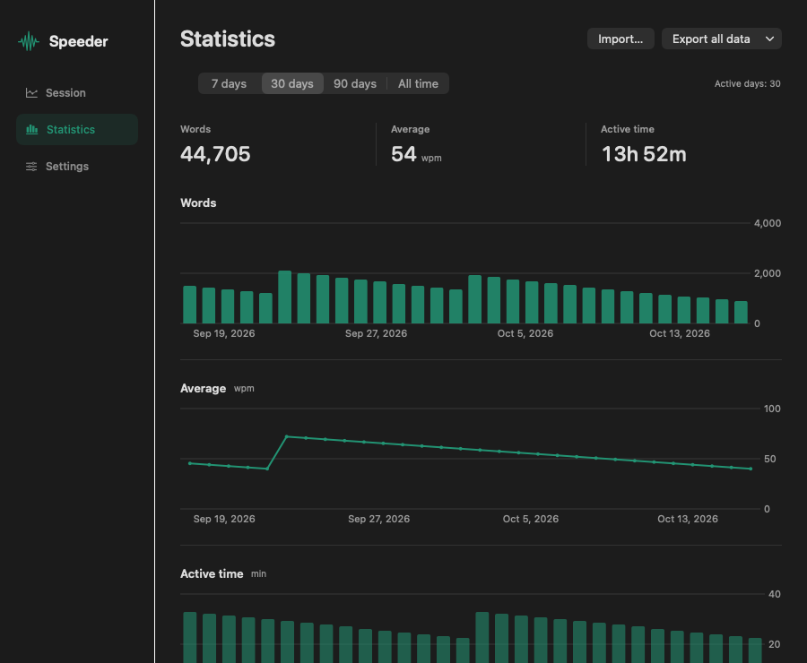

# Speeder

[](https://github.com/mmattia09/speeder/actions/workflows/ci.yml)
[](https://github.com/mmattia09/speeder)
[](Package.swift)
[](LICENSE)

A macOS menu-bar app that shows how fast you are typing. It lives next to the
clock as a small spider, counts keystrokes while you write — in any app — and
turns them into words per minute, live and just after you stop. Open it for the
rest: current burst, session average, peak, and history.


*Session window with example statistics. Light and dark appearance follow macOS.*

Speeder includes an app icon and follows your macOS language: **English, Italian,
French, Spanish or German**. Other languages fall back to English.

## What it measures

- **Current** — estimated words per minute over a 5 second sliding window (5
  characters per word, the usual typing-test convention). Typed characters minus deletions determine the rate. It stays visible after you stop, so the last burst stays readable while you think.
- **Burst** — the best rate reached in the run you are typing right now. A pause
  longer than 1.5 seconds closes the burst and the counter starts over.
- **Average** — words typed over the time you were actually typing. Pauses count
  as 1.5 seconds each, so a coffee break does not deflate your average.
- **Peak** — the fastest you have been in this session.
- **History** — the live rate sampled once per second, drawn as a sparkline.

A word counts when a space, return or tab follows at least one character, so
backspacing undoes the word you are typing instead of inflating the count. ⌘, ⌥ and ⌃
shortcuts, function keys and arrows are ignored. Option-modified characters are
excluded too; this is a keystroke estimate, not a count of committed text or
IME output.

## Requirements

macOS 13 or later; Swift 6 or later to build. Speeder needs **Accessibility** permission to see your
keystrokes: the first-launch introduction explains it, and you can also flip the switch from
Settings with *Accessibility Settings…*. Key events are inspected only to classify typing, separators and deletions.
Their text is immediately discarded. Recent timing samples stay in memory;
numeric minute summaries are saved locally for long-term statistics. No network
requests or telemetry. Quitting clears the live session but keeps the history.

## Install

Download **Speeder-0.2.1-macos-universal.zip** from the
[latest release](https://github.com/mmattia09/speeder/releases/latest), unzip it,
and move Speeder.app to Applications. It runs on Apple Silicon and Intel Macs
with macOS 13 or later. The app is ad-hoc signed and not notarized, so Gatekeeper
may warn when you first open it.

Or build from source:

```sh
git clone https://github.com/mmattia09/speeder.git
cd speeder
Scripts/build-app.sh          # builds dist/Speeder.app
open dist/Speeder.app         # then grant Accessibility access when asked
```

The app is ad-hoc signed, without a Developer ID or notarization, so macOS may require
*right-click → Open* the first time. For hacking on it, `swift run Speeder`
works too.

## Use

Click the small, monochrome spider for a compact popover: current pace, a recent
sparkline, average, peak and word count. Pause or resume capture with one click.

**More statistics** opens the Statistics page: view the last 7 days, 30 days or
all recorded activity, with daily word counts, weighted average speed, peak and
active time. **Export all data** saves every minute summary as JSON or CSV,
regardless of the selected date range.

The **Session** page has the live speed graph, goal reference, burst and session
metrics. Hover over either speed graph to see WPM and the actual sample time.
Pauses take no space on the speed graphs: typing runs join on an active-time
axis, while hover details retain the actual timestamps. Daily activity uses
equally spaced recorded days, omitting days without activity.

The menu-bar number averages batches of five keystroke rates. A partial batch
is shown after 1.5 seconds of inactivity. The graphs and session metrics retain
the unsmoothed rates.

Reset clears the current session only; long-term history remains. Closing the
window keeps Speeder in the menu bar.

**Settings** (the gear, or ⌘,) lets you hide the menu-bar number, turn spider
animation off, choose a goal from 10 to 200 WPM, and pick an accent color (presets
or any custom color). These preferences persist. Animation respects Reduce Motion.

Enable **Launch Speeder at login** in Settings after moving the app to
Applications. It uses macOS Login Items; if system approval is needed, the app
links to the relevant settings. This option is off until you enable it.

On first launch, a three-step introduction explains how Speeder works before
offering Accessibility access. You can skip permission setup and return to it
later, or replay the introduction from Settings. Quit with the popover's Quit
button or ⌘Q while the app window is active.



## Local history and export

History begins with version 0.2.0; older versions did not save it. The database
is `~/Library/Application Support/Speeder/statistics.sqlite`. It contains minute
summaries, never text, app names or individual key codes. Updates are committed
every ten seconds and on pause, reset and normal quit; a crash can lose the most
recent uncommitted seconds. Disk errors appear on the Statistics page.

Exports include the complete recorded history. JSON includes a schema version
and UTC Unix timestamps; CSV uses ISO 8601 UTC timestamps. Each minute contains
completed words, keystrokes, active seconds, peak WPM, the sum of sampled WPM and
the sample count. The daily average uses total completed words divided by total
active time; `rateSum / samples` is the mean of live-rate samples instead.

## Development

```sh
swift build                   # build everything
Scripts/test.sh               # run metrics and key-classification tests
swift run Speeder             # run the app from the command line
Scripts/build-app.sh          # assemble dist/Speeder.app
Scripts/build-app.sh release universal # Apple Silicon + Intel release bundle
```

With full Xcode, `swift test` works directly. `Scripts/test.sh` also supports
recent Command Line Tools installations that ship `Testing.framework` but omit
its Foundation overlay. Older installations without a test framework need full
Xcode. CI runs the tests and packages an app artifact on every push.

The project is a Swift package with three libraries and one executable:

| Target          | What lives there                                                        |
| --------------- | ----------------------------------------------------------------------- |
| `SpeederCore`   | `TypingSession` and `WPMFormatter`: pure Foundation, no UI, no event taps |
| `SpeederShims`  | a two-line C shim around a CoreFoundation call Swift cannot see reliably |
| `SpeederCapture`| `KeystrokeMonitor` (`CGEventTap` session tap) and `KeyClassifier`         |
| `Speeder`       | the menu-bar item, the animated spider and the detail panel (SwiftUI)     |

The split keeps the interesting part — the maths — free of AppKit, so it can be
tested without a window server. Tests cover the sliding window, the freeze after
a pause, burst and peak handling, backspaces, pause handling in the average, and
history sampling, long sessions, clock changes and key classification.

## Troubleshooting

- **No speed updates:** grant access under System Settings → Privacy & Security →
  Accessibility. Speeder checks for permission changes every two seconds.
- **Still no capture after a rebuild:** remove the old Accessibility entry, add
  the rebuilt app and relaunch it. Keep the app in a stable location.
- **Password fields:** macOS Secure Input can prevent global capture. Speeder
  does not bypass it.
- **History and averages:** history samples are collected during typing; pauses are excluded from
  the horizontal axis. Hover to inspect the actual sample time. Average counts completed words;
  Current uses five characters per word and subtracts deletions. They can differ.

### Interface previews

```sh
swift run Speeder --render-previews /tmp/speeder-previews
```

Debug builds can export the actual SwiftUI views in light and dark appearance,
using synthetic statistics and isolated preferences, without starting capture.
This includes the popover, session, long-term statistics, settings, custom accent,
introduction and an empty session
at the minimum window size. The export option is absent from release builds.

### Icons and translations

The app icon is a vector drawing rendered at all standard macOS icon sizes:

```sh
swift Scripts/generate-icon.swift /tmp/Speeder.iconset
iconutil -c icns /tmp/Speeder.iconset -o Resources/AppIcon.icns
```

Translations live in `Scripts/localizations.txt` (English key followed by Italian,
French, Spanish and German, separated by `|`). Regenerate and validate them with:

```sh
python3 Scripts/generate-localizations.py
python3 Scripts/check-localizations.py
```

The build copies the `.lproj` folders into the app bundle. To visually check a
language, build a debug bundle and invoke its executable:

```sh
Scripts/build-app.sh debug
dist/Speeder.app/Contents/MacOS/Speeder --render-previews /tmp/speeder-it -AppleLanguages '(it)' -AppleLocale it_IT
```

Idle snapshots do not republish unchanged statistics. The menu-bar spider caches
its static image and only renders frames when animating or changing displays.

## Contributing

Questions, bug reports and pull requests are welcome —
[open an issue](https://github.com/mmattia09/speeder/issues).

## Authors and acknowledgment

Made by [@mmattia09](https://github.com/mmattia09). Developed with the help of
[Claude Code](https://claude.com/claude-code) and [Codex](https://openai.com/codex/).

## License

[MIT](LICENSE).
